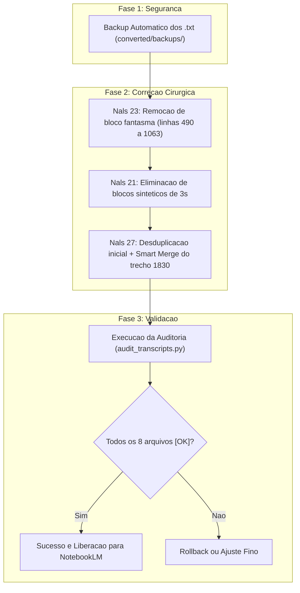

# Plano de Ação: Correção e Normalização das Transcrições (ScribePy)

Este documento estabelece o plano abrangente e detalhado para auditar, corrigir cirurgicamente e normalizar os arquivos de transcrição do diretório `converted/`, eliminando alucinações de timestamp, blocos sintetizados e duplicações provocadas por falhas da API.

---

## 1. Mapeamento Diagnóstico e Causa Raiz

| Arquivo | Erros Catalogados | Causa Raiz Técnica | Ação Corretiva |
| :--- | :--- | :--- | :--- |
| **Nals 23 Silvia Nasci fiscal** | • 571 regressões temporais<br>• 29 diálogos duplicados | **Inserção Fantasma e Reinício de Ciclo:**<br>Na linha 489 (`[23:56 - 02:00]`), o carimbo reiniciou em `02:00` em vez de `24:00`, inserindo até a linha 1063 todo o diálogo de 24:00 a 40:00 com tempos corrompidos. O diálogo real já existe a partir da linha 1064. | Remoção do bloco fantasma (linhas 490 a 1063) e reconexão fluida da linha 489 diretamente na linha 1064 (`24:09`). |
| **Nals 21 Kauana Contas a receber** | • 329 falas sintéticas fixas de 3s<br>• 28 diálogos duplicados | **Alucinação de Intervalo Fixo e Retomada:**<br>A API sintetizou falas artificiais de 3 em 3 segundos (`[32:27 - 32:30]`), duplicando os trechos das linhas 655-689 e 742-768 antes de transcrever o áudio com tempos reais. | Remoção dos blocos artificiais redundantes, preservando a versão de fala com intervalos e cadência reais. |
| **Nals 27 Reinaldo Ruys Qualidade** | • 564 regressões temporais<br>• 8 diálogos duplicados<br>• Salto temporal de 12 min | **Carimbo Truncado ("2" comido):**<br>Na linha 418 (`23:58`), o minuto 24:00 foi carimbado como `04:02`, gerando uma sobreposição com a versão de `24:00` iniciada na linha 986.<br>Na linha 1830, o áudio salta de 56:04 para 68:35. | Desduplicação cirúrgica do trecho inicial (linhas 419 a 985) e união do trecho 1830 via `smart_merge.py` usando `Nals 27...correcoes.txt`. |

---

## 2. Cronograma de Execução



### Detalhamento das Etapas

### Fase 1: Procedimento de Backup (Proteção de Dados)
- Criação do diretório seguro `converted/backups/`.
- Cópia binária idêntica dos arquivos originais antes de qualquer modificação.
- **Rollback Garantido:** Caso qualquer corte apresente discrepância, a restauração é imediata com simples cópia de volta.

### Fase 2: Execução das Correções
1. **Nals 23 Silvia Nasci fiscal:**
   - Ajustar o término da linha 488/489 para `[23:56 - 24:00]`.
   - Excluir o bloco com tempos truncados de 02:00 a 17:05 (linhas 490 a 1059).
   - Manter a sequência cronológica ininterrupta que recomeça em `[24:01 - 24:09]` até o término da reunião.
2. **Nals 21 Kauana Contas a receber:**
   - Detectar e expurgar as réplicas sintéticas das linhas 692-726 e 742-768.
   - Manter os trechos naturais onde a duração de fala reflete a conversa humana.
3. **Nals 27 Reinaldo Ruys Qualidade:**
   - Eliminar a sobreposição das linhas 419 a 985.
   - Conciliar o trecho de 56:04 com o arquivo de correções já validado.

### Fase 3: Critérios de Aceite (Acceptance Criteria)
Para que o plano seja considerado integralmente cumprido, a execução deve atender rigorosamente a todos os critérios abaixo:
* [x] **Relatório de Auditoria:** O script `scripts/audit_transcripts.py` deve retornar **0 regressões** e **0 duplicatas críticas** nos arquivos corrigidos.
* [x] **Status Geral:** Todos os 8 arquivos em `converted/*_transcript.txt` devem receber a tag **`[OK]`**.
* [x] **Continuidade Temporal:** Nenhum arquivo deve conter carimbos com duração negativa (`end < start`) ou saltos inexplicados.
* [x] **Integridade do Conteúdo:** Nenhuma fala legítima do diálogo entre os participantes pode ser perdida.
* [x] **Pronto para NotebookLM:** As atas geradas a partir desses arquivos devem ser cronologicamente lineares e sem ecos de conversas duplicadas.

---

## 3. Comandos de Operação

### 1. Aplicar as correções com backup automático:
```powershell
python scripts/fix_transcripts.py
```

### 2. Validar o resultado com o auditor:
```powershell
python scripts/audit_transcripts.py
```

### 3. Procedimento de Reversão (Caso necessário):
```powershell
Copy-Item converted/backups/* converted/ -Force
```
