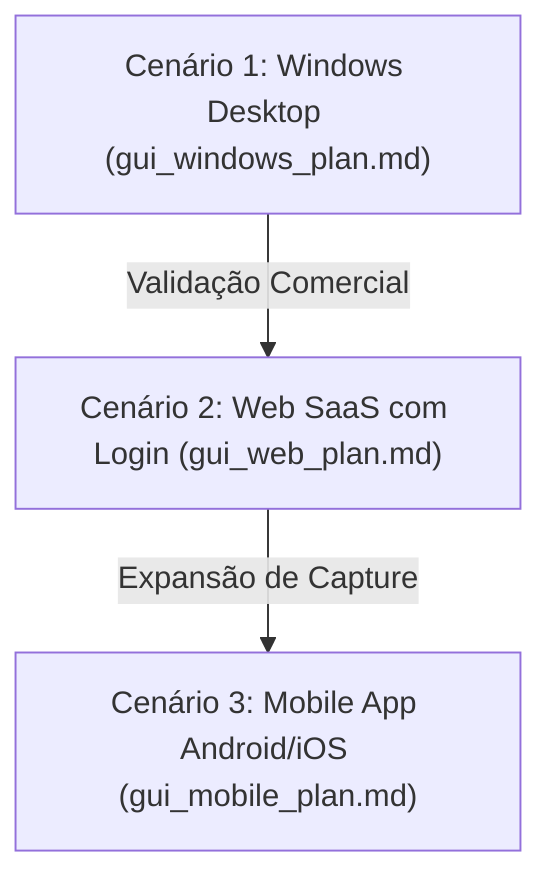

# Plano de Implantação: Interface Gráfica ScribePy (GUI RoadMap & Arquitetura)

Este documento estabelece o roadmap estratégico, arquitetura de software e diretrizes de desenvolvimento para a transformação do ScribePy de um aplicativo de terminal para uma solução multiplataforma moderna. 

O projeto adotará uma abordagem de **implantação modular e em fases**, executando uma entrega de cada vez para garantir estabilidade e governança.

---

## 🎨 Diretrizes de Design & UX/UI (Estilo Windows 11)

Independente da plataforma, a identidade visual deve ser moderna e seguir o **Fluent Design do Windows 11**:
1. **Modo Escuro (Dark Mode)** ativo por padrão com suporte a paletas harmoniosas de cinza escuro e azul acentuado.
2. **Cantos Arredondados** em todos os botões, caixas de texto e painéis.
3. **Tipografia Moderna**: Uso da fonte padrão do sistema, `Segoe UI Variable` ou `Segoe UI`.
4. **Feedback de Estado**: Transições suaves nos botões ao passar o mouse (hover) e barras de progresso fluidas com porcentagem em tempo real.

---

## 🛣️ Roadmap Estratégico: Os 3 Cenários de Implantação

Para manter o foco no desenvolvimento, dividiremos a expansão comercial e técnica em 3 cenários distinctos e sucessivos. Cada cenário será regido por seu próprio arquivo de plano detalhado:



### 1️⃣ Cenário 1: Windows Desktop (Foco Inicial)
* **Arquivo de Planejamento**: [gui_windows_plan.md](file:///c:/00_Projects/ScribePy/gui_plans/gui_windows_plan.md)
* **Objetivo**: Criar o aplicativo nativo para Windows. Foco em processamento local e uso de APIs com as credenciais do próprio usuário.
* **Canal de Distribuição**: Instalador portátil (`.exe` standalone via PyInstaller) e posterior publicação na **Windows Store**.
* **Público**: Diretores, coordenadores industriais e analistas de processos que organizam relatórios diretamente no desktop.

### 2️⃣ Cenário 2: Web SaaS com Login (Fase de Escala)
* **Arquivo de Planejamento**: `gui_web_plan.md` (a ser criado no início da Fase 2)
* **Objetivo**: Migrar o processamento de áudio para um servidor em nuvem (ex: FastAPI no backend) e criar uma interface web moderna (React ou Vue). 
* **Modelo**: Venda de pacotes de minutos e assinaturas mensais recorrentes controladas por login e senha, com processamento centralizado.
* **Público**: Empresas de consultoria que precisam de acesso rápido em qualquer máquina (Windows, Mac) sem instalar arquivos.

### 3️⃣ Cenário 3: Aplicativo Mobile (Fase de Mobilidade)
* **Arquivo de Planejamento**: `gui_mobile_plan.md` (a ser criado no início da Fase 3)
* **Objetivo**: Criar uma interface leve para celulares focada em gravar o áudio no chão de fábrica e enviar o arquivo de forma simplificada para o servidor do Cenário 2.
* **Público**: Operadores de fábrica e consultores em campo gravando diálogos técnicos em tempo real.

---

## 📁 Boas Práticas de Organização de Arquivos

Para que o código-fonte cresça de maneira organizada e permita que o mesmo motor lógico sirva ao Desktop, Web e Mobile, adotaremos uma **Arquitetura Modular Limpa (Clean Architecture)** baseada na pasta `gui/`:

```text
ScribePy/
├── main.py                     # Entry point CLI atual (suporte à flag 'clear')
├── .env                        # Credenciais + Rota + Modo de Áudio (AUDIO_MODE)
├── src/                        # Core Engine (Lógica de processamento e APIs)
│   ├── audio_processor.py      # Resampling, Noise Reduce, Slicing
│   ├── pipeline.py             # Checkpoints, Retomadas e Orquestração
│   ├── transcriber_gladia.py   # Integração Gladia
│   └── transcriber_gemini.py   # Integração Gemini
│
└── gui/                        # Novo diretório para as interfaces visuais
    ├── docs/                   # Documentações e planos de implantação da GUI (esta pasta)
    │   ├── gui_implementation_plan.md
    │   └── gui_windows_plan.md
    │
    ├── common/                 # Recursos e lógicas compartilhadas
    │   ├── assets/             # Ícones, imagens corporativas e temas CSS
    │   └── controllers/        # Controladores lógicos (pontes com o src/pipeline.py)
    │
    ├── desktop/                # Códigos exclusivos do Cenário 1 (Windows)
    │   ├── gui_main.py         # Entry point do aplicativo de mesa
    │   └── components/         # Widgets Fluent personalizados (PySide6)
    │
    ├── web/                    # Códigos exclusivos do Cenário 2 (Web SaaS)
    │   └── ...                 # Componentes React/Vue do frontend
    │
    └── mobile/                 # Códigos exclusivos do Cenário 3 (Mobile App)
        └── ...                 # Telas em Flutter ou React Native
```

---

## 🔢 Sistema de Versionamento

Seguiremos o padrão de **Versionamento Semântico (SemVer)** ajustado para os nossos cenários:

```text
Formato: MAJOR.MINOR.PATCH
           |     |     |
           |     |     +--> Correções de bug, refatoração de prompt (Ex: 1.0.1)
           |     +--------> Novo modelo adicionado, melhorias na UI do cenário (Ex: 1.1.0)
           +--------------> Lançamento de um novo Cenário ou quebra de compatibilidade (Ex: 2.0.0)
```

### Estrutura de Branches no Git para Evolução Modular:
* **`main`**: Código de produção perfeitamente testado e estável.
* **`develop`**: Linha de integração de recursos em teste.
* **`v8-gladia`**: Branch atual para a finalização da API Gladia.
* **`v9-gui-windows`**: Futura branch exclusiva para o desenvolvimento do **Cenário 1**.
* **`v10-gui-web`**: Futura branch exclusiva para o desenvolvimento do **Cenário 2**.

---

## 📄 Estrutura de Changelog Duplo (Exemplo de Governança)

Manteremos dois registros de histórico de alterações separados para atender aos dois públicos do projeto:

### ⚙️ Changelog Técnico (Focado em Desenvolvimento)
*Registra alterações na arquitetura, performance, refatorações e integrações de API.*

* **v8.0.0 (2026-06-24)**
  * **[NEW]** Criado módulo `src/transcriber_gladia.py` para integração com Gladia API v2.
  * **[ADD]** Implementado `_extract_vocabulary_terms` para limpar e extrair tabelas e negritos do glossário Markdown.
  * **[MOD]** Atualizado `src/transcriber_dispatcher.py` para mapear e despachar chamadas sob demanda para Gladia.
  * **[MOD]** Adicionada dependência `requests>=2.31.0` no `requirements.txt`.

* **v8.1.0 (2026-06-24)**
  * **[NEW]** Adicionada flag de linha de comando `clear` ao `main.py` — roteia o parâmetro `noise_reduce=True|False` para o pipeline.
  * **[MOD]** `src/pipeline.py`: novo parâmetro `noise_reduce` propagado ao pré-processador com exibição do modo no cabeçalho do log.
  * **[MOD]** `src/audio_processor.py`: `preprocess_audio()` agora é condicional — executa `noisereduce` apenas quando `noise_reduce=True`.
  * **[PLAN]** Documentada a UX/UI do toggle `🏭 Fábrica (Clear) / 🏢 Escritório (Clean)` nos planos da GUI.

### 💼 Changelog Comercial (Focado em Produto e Negócios)
*Registra novos recursos ao usuário final, melhorias de UX, precificação e distribuição comercial.*

* **v8.0.0 (2026-06-24)**
  * **[NEW]** Adicionado suporte para a **API Gladia**, oferecendo transcrição super rápida (8 min de áudio processados em 14s).
  * **[NEW]** Diarização profissional de participantes ativada sem custo adicional por meio da nova API.
  * **[NEW]** Sincronização automática do seu glossário técnico de fábrica para correção de termos como "Pebolim" e "Nals Alumínio".

* **v8.1.0 (2026-06-24)**
  * **[NEW]** Suporte ao **Modo de Ambiente** na linha de comando: basta adicionar `clear` antes do arquivo de áudio para ativar a supressão de ruído industrial (chão de fábrica), ou omiti-lo para manter o volume natural de áudios gravados em escritórios ou salas de reunião.
  * **[IMPROVE]** Áudios de ambientes silenciosos processam mais rápido e com volume mais alto (sem aplicação do noisereduce que reduzia o ganho).

