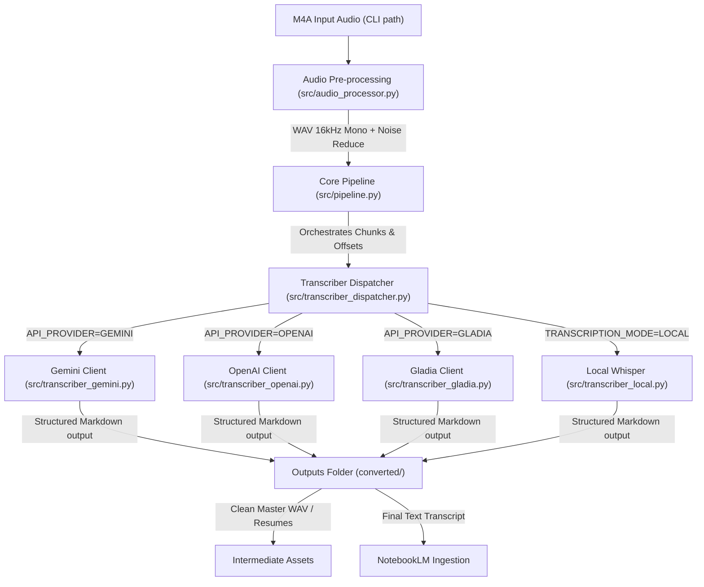

# Infrastructure and Architecture: ScribePy

This document outlines the architecture, pipeline stages, token/cost optimization strategies, and directory organization of the ScribePy transcription tool up to version **v8**.

## Technical Architecture

ScribePy is designed under a decoupled facade-based pipeline using a `src/` package layout. The framework isolates intermediate audios, slices, and outputs inside the `converted/` workspace, safeguarding configuration and repository source files.



---

### Directory Structure & Organization

```text
ScribePy/
├── .env                          # API Credentials, Routing Mode, and Model configurations
├── README.md                     # Main user guide and setup instructions
├── main.py                       # CLI Wrapper entry point (orchestrates execution arguments)
├── infrastructure.md             # Architectural Blueprint (this file)
├── glossario.txt                 # Custom factory jargon list or Markdown table
├── converted/                    # Isolated execution output workspace (git ignored)
│   ├── {audio}_clean.wav         # Pre-processed clean master audio
│   ├── {audio}_resume.wav        # Temporary sliced wav for smart resume checkpoint
│   └── {audio}_transcript.txt    # Final formatted transcript output
│
├── src/                          # Business logic engine
│   ├── __init__.py               # Registers src/ as a Python package
│   ├── audio_processor.py        # Local audio manipulation (16kHz, noisereduce, slicing)
│   ├── pipeline.py               # Orchestrator loop (checkpoints, resumes, merges chunks)
│   ├── transcriber_dispatcher.py # Facade Router (reads .env configurations and forwards jobs)
│   ├── transcriber_gemini.py     # Google Gemini API integration (with native file upload)
│   ├── transcriber_openai.py     # OpenAI Whisper-1 API integration
│   ├── transcriber_gladia.py     # Gladia v2 API integration (with async polling and parser)
│   ├── transcriber_local.py      # Offline faster-whisper CPU integration
│   ├── spinner.py                # Multithreaded console UX loader spinner
│   └── cleaner.py                # File system cleanup utilities
│
├── gui/                          # Roadmap assets for desktop/web expansion
│   └── docs/                     # Visual design and platform roadmaps
│       ├── gui_implementation_plan.md # UI/UX layout and multi-scenario strategy
│       └── gui_windows_plan.md        # Scenario 1 (Windows Desktop App design)
│
└── scripts/                      # Utility scripts
    ├── cleanup.py                # Deletes intermediate files in converted/
    ├── fix_by_time.py            # Surgical audio chunk re-transcription helper
    ├── smart_merge.py            # LLM-based intelligent transcript conciliator
    └── fix_ranges.txt            # Timestamp targets for manual segment corrections
```

---

## Technical Flow & Components

### 1. The Dispatcher Router (`src/transcriber_dispatcher.py`)
* Acts as a Facade design pattern. It evaluates the `.env` settings (`TRANSCRIPTION_MODE` and `API_PROVIDER`) to dynamically load and call the requested transcription service using lazy imports.
* standardizes the returned metadata block (`usage_data`) so that the orchestrator pipeline calculates totals transparently.

### 2. Smart Resume & Checkpoint System
* Before starting a job, `src/pipeline.py` parses the target output file `{audio}_transcript.txt` looking for the `--- FIM ---` tag or valid timestamps like `[MM:SS - MM:SS]`.
* If a partial transcription is found, it extracts the last timestamp offset (e.g. `44:06`), cuts the remaining audio starting from `43:56` (including a **10-second overlap** to ensure context continuity), uploads only the sliced chunk, and appends the new results to the text file.
* This ensures resilience against internet drops, backend crashes, or API token limits, reducing financial costs.

### 3. Smart Glossary Parser (Gladia API)
* Unlike Gemini, which understands rich Markdown glossary instructions, the Gladia v2 API requires a flat array of words (`custom_vocabulary`).
* `src/transcriber_gladia.py` implements the `_extract_vocabulary_terms()` helper, which automatically parses markdown tables and list negritos in `glossario.txt` and isolates clean technical words (e.g., removing brackets, parentheses and explanations) to avoid poisoning Gladia's phonetic matching system.

---

## Token Optimization & Cost Strategies

ScribePy supports detailed cost tracking across different providers. The cost calculations are performed dynamically on each executed chunk:

### 1. Cost Calculations by Provider (as of v8)
* **Google Gemini (gemini-3.1-flash-lite)**: 
  * Audio tokenization is duration-based: **1 second of audio ≈ 266 tokens**.
  * Input cost: USD $0.075 / 1M tokens. Output cost: USD $0.30 / 1M tokens.
* **OpenAI API (whisper-1)**:
  * Priced on a flat rate per second: **USD $0.006 per minute** of audio processed.
* **Gladia API v2 (solaria-1)**:
  * Priced at **USD $0.61 per hour** of audio (async processing). Includes multi-speaker diarization out-of-the-box.
* **Whisper Local**:
  * Free offline execution (Cost = $0.00).

### 2. Audio Downsampling
* ScribePy pre-processes every audio file down to **16kHz, Mono, 16-bit PCM WAV** payload before network transfer.
* Reduces network latency during API upload phases and optimizes input token weight on multimodal API configurations.
